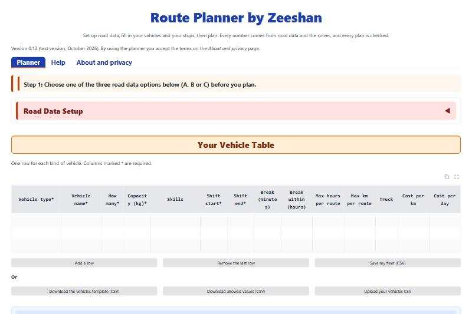
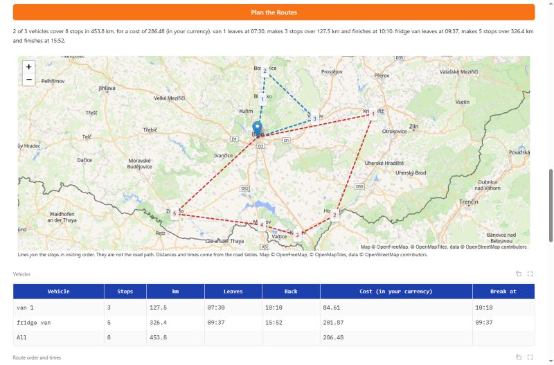
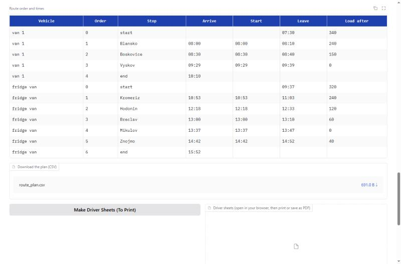
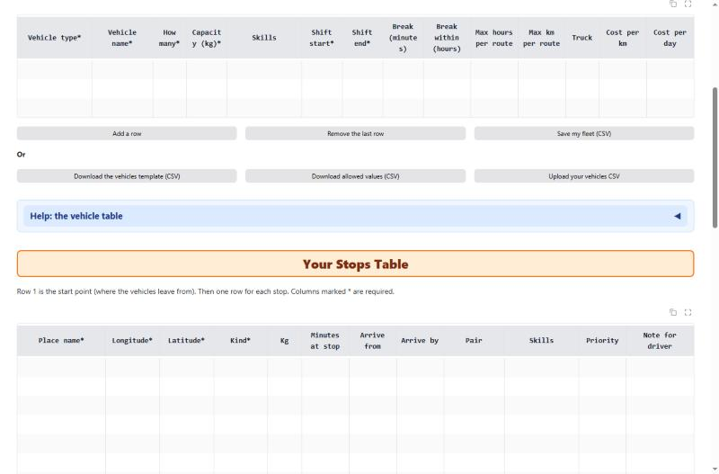
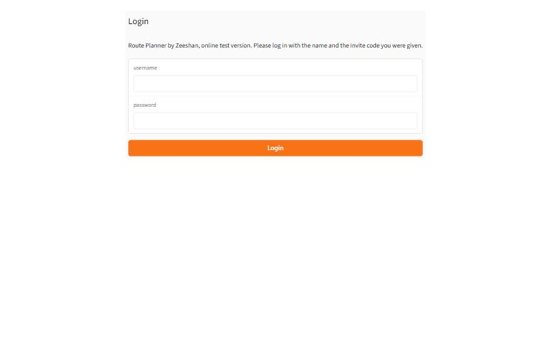

# Route Planner by Zeeshan

A delivery route planner for small and medium transport businesses. You enter your vehicles and your stops, and the
planner works out which vehicle drives to which stop, in which order, and at what time. It uses real road distances
and checks every plan against your rules before it shows it.

This page shows what the planner does. It holds no program code and no installer.

## Watch the 1-minute demo

https://github.com/user-attachments/assets/c84af1d5-d320-47fd-b11d-efb5f24cc5e8

<video src="video/route-planner-demo.mp4" poster="screenshots/3-plan-with-map.jpg" controls muted playsinline width="100%"></video>

## Who it is for

- Delivery and courier companies, wholesalers, bakeries, caterers and shops with their own vans.
- Dispatchers who plan routes by hand today, in a spreadsheet or on paper.
- Fleets of up to 20 vehicles and up to 50 stops per plan.

## What it does

- **Real road distances.** Distances and driving times come from road data (OpenStreetMap), not from straight lines.
  The routes are worked out with Google OR-Tools, a proven route solver.
- **Your vehicles.** Vehicle types from a car to a 40 tonne truck, capacity in kg, shift times, driver breaks,
  maximum hours and km per route, and skills such as refrigerated, tail lift or two-person crew.
- **Your stops.** Deliveries, collections, and pickups that go to a matching drop-off, with time windows, minutes at
  each stop, the skills a stop needs, priorities, and a note for the driver.
- **Costs, if you want them.** Enter a cost per km and per day for each vehicle, in your own currency, and the
  planner finds the cheapest plan. Without costs it finds the shortest plan.
- **Clear checks.** Before planning, the planner checks both tables and lists every problem by table, row and column,
  for example "Stops, row 4: Longitude is empty." If no plan can meet all your rules, it says which rule blocks it.
- **What IF ?** Try one or several changes, such as an extra van, a different time window or a stop left out, and
  compare the result with today's plan before you decide.
- **Mid-Day Re-Plan.** Mark the stops that are done, add urgent new stops, and plan the rest of the day from where
  each vehicle is now.
- **Driver sheets.** One printable page per driver, with the stops in order, arrival times, time windows, kg and
  notes.
- **Easy data entry.** Type into the tables on the screen, or download a CSV template, fill it in Excel and upload it.
- **No AI guessing.** Every number comes from the road data and the solver, and every plan is checked.

## How it is offered

- **On your own PC.** The planner runs on the customer's own Windows computer. Your vehicles, stops and plans stay
  on your PC. Road distances come either from road data on your own PC, so your stops never leave it, or from your
  own free OpenRouteService key, which sends only the map points of your stops to OpenRouteService.
- **Online test version, by invitation.** To try it first, you can get a personal test login with 3 free plans. The
  online test version works in your web browser, with nothing to install.

## Request a free test login

Fill in the short form and you will get your personal login by email:

**[Request a test login](https://docs.google.com/forms/d/e/1FAIpQLSccvydDKASJ4l2F1hkGHdX7_rL3U6lDiYqO67w6XQ-9FvHKkA/viewform)**

Please use made-up or public places when you test, not real customer addresses.

## Feedback

Your feedback shapes the next version. Tell us what was easy, what was confusing, and anything that went wrong:

**[Send feedback](https://forms.gle/5JAh7uf1Xzhm87Su9)** or write to **[route.planner.zeeshan@gmail.com](mailto:route.planner.zeeshan@gmail.com)**

## Status

Test phase, October 2026. The planner is checked by more than 150 automatic tests, and it was tried on real road
data for the Czech Republic.

## Credits

Road data © OpenStreetMap contributors (ODbL). Route solver: Google OR-Tools (Apache 2.0). Road distances:
OpenRouteService by HeiGIT, or OSRM. Map pictures: © OpenFreeMap, © OpenMapTiles. Screen: Gradio (Apache 2.0).

## Copyright

All rights reserved. Copyright 2026 Zeeshan Malik. See [LICENSE](LICENSE).
